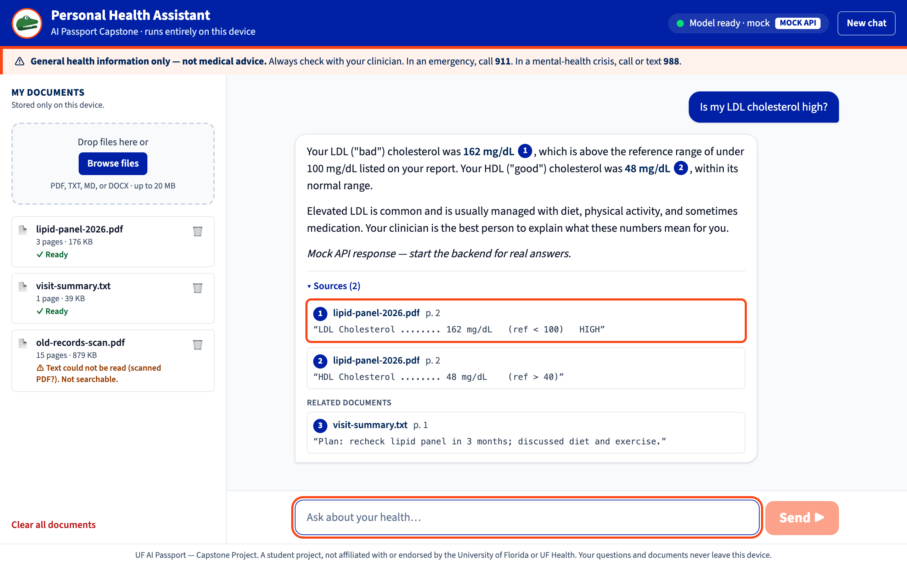
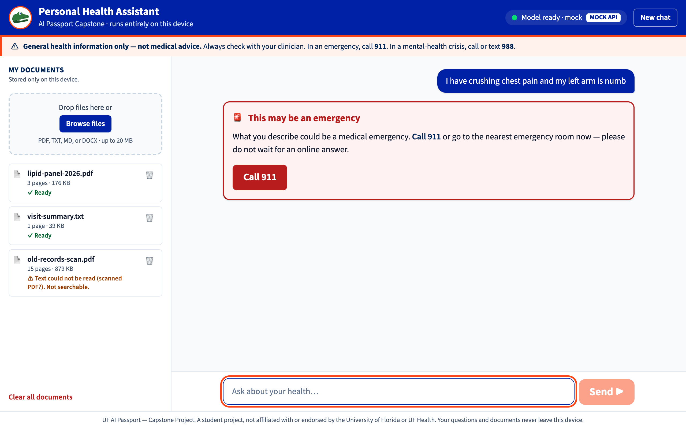
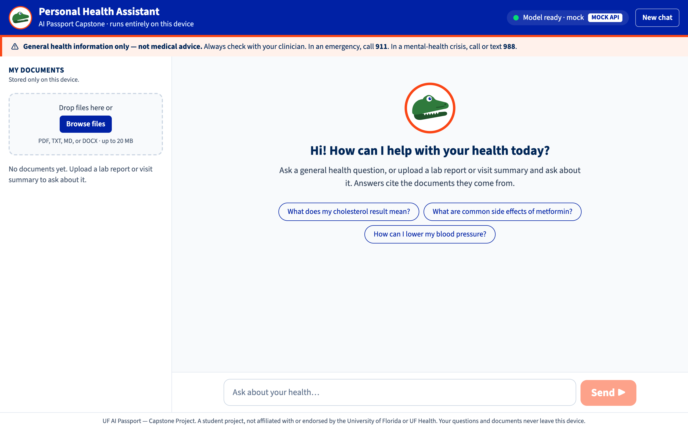
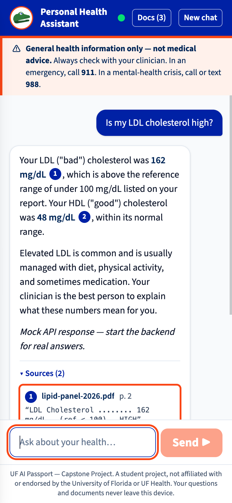
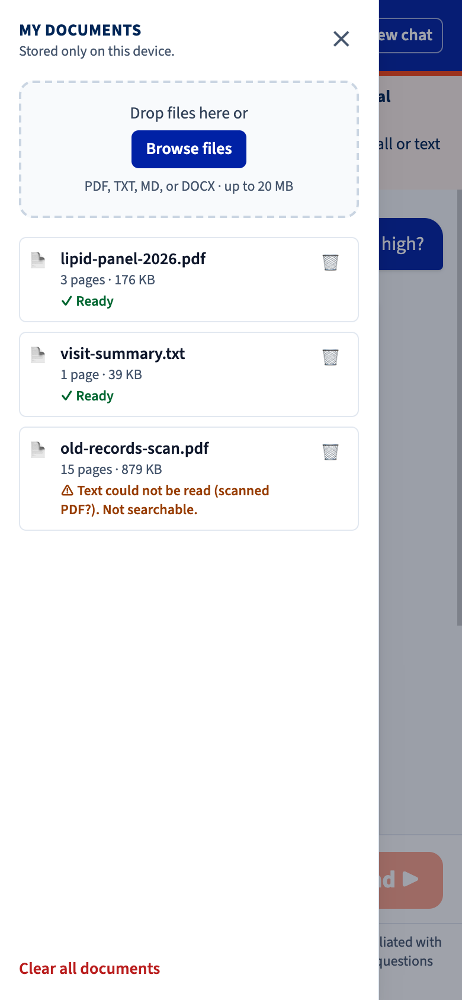

# Personal Health Assistant 🐊

UF AI Passport — Clinical Application Track, **Project 7 (Capstone)**.
Brief: <https://uf-aibhs.github.io/AI-Passport-Impact-Project/clinical-application-project-07-capstone-health-assistant/>

A fully **local** health assistant: Phi-3-mini fine-tuned with LoRA on MedQuAD, grounded at query
time in documents you upload (RAG over Chroma). Your questions and documents never leave your machine.

> ⚠️ **Medical disclaimer** — This is a student project that provides general health information only.
> It is **not** a substitute for professional medical advice, diagnosis, or treatment.
> In an emergency, call **911**. For a mental-health crisis, call or text **988**.
>
> Not affiliated with or endorsed by the University of Florida or UF Health.

## Screenshots

| Grounded answer with citations | Emergency guidance |
|---|---|
|  |  |

| Welcome | Mobile chat | Mobile documents |
|---|---|---|
|  |  |  |

_Screenshots use the built-in mock API (`make dev-mock`); answers shown are illustrative, not real model output._

## Architecture

```
                ┌──────────────────────── LOCAL MACHINE ────────────────────────┐
  browser ───▶  │  React UI ──/api──▶ FastAPI ──┬──▶ Retriever ──▶ Chroma        │
                │                               │       ▲                       │
                │                               │   local embeddings            │
                │                               ▼                               │
                │                     Ollama (127.0.0.1:11434)                  │
                │                     phi3-medquad (LoRA, GGUF Q4_K_M)          │
                └───────────────────────────────────────────────────────────────┘
  Training (one-time, public data only): Colab GPU → LoRA adapter → GGUF → Ollama
```

## Repository layout

| Path        | Contents                                                     |
|-------------|--------------------------------------------------------------|
| `backend/`  | FastAPI app (Python package `pha`) and tests                 |
| `frontend/` | Vite + React + TypeScript + Tailwind UI                      |
| `training/` | MedQuAD preparation, LoRA notebook, GGUF export              |
| `eval/`     | Evaluation harness and report                                |
| `models/`   | GGUF weights + Ollama Modelfiles (weights are gitignored)    |
| `data/`     | Chroma store, uploads, datasets (gitignored)                 |
| `openspec/` | Proposals, designs, specs, and task lists                    |

## Prerequisites

- Python 3.11 (managed automatically by [uv](https://docs.astral.sh/uv/))
- Node.js 20+
- [Ollama](https://ollama.com/) (needed from the chat feature onward)

## Quick start

```bash
make setup     # install backend + frontend dependencies
make dev       # backend on 127.0.0.1:8000, frontend on 127.0.0.1:5173
make dev-mock  # UI only, against an in-memory mock API (no backend/Ollama needed)
make start     # build the UI and serve UI + API together at http://127.0.0.1:8000
make test      # run all tests
make lint      # ruff + oxlint + tsc
```

Without `make`:

```bash
cd backend && uv sync && uv run uvicorn pha.main:app --host 127.0.0.1 --port 8000 --reload
cd frontend && npm install && npm run dev        # or: npm run dev:mock
```

Configuration is via `PHA_`-prefixed environment variables or `backend/.env` — see `backend/.env.example`.

## Running with a local model

The default model is `phi3-medquad` (the fine-tuned model, built in `training/`). Until it exists,
any installed Ollama model works for development:

```bash
PHA_MODEL=llama3.2 make dev          # or: PHA_MODEL=llama3.2 make start
PHA_LLM_BACKEND=fake make dev        # no Ollama at all: canned answers, real retrieval
```

One-time setup for document search: `cd backend && uv run python scripts/fetch_embeddings.py`.

### Measured performance

Apple M3 Max, `llama3.2` (3.2B, Q4_K_M) via Ollama 0.32, three fixture documents indexed,
retrieval top-4 with bge-small-en-v1.5:

| Metric | Result |
|---|---|
| Time to first token (warm model) | 0.25–0.7 s |
| Generation speed | ~110 tokens/s |
| Emergency response (no model call) | ~15 ms |
| Backend startup (embedding model load) | ~3 s |

Numbers for `phi3-medquad` will be added by the evaluation suite.

## Privacy guarantees

- Backend and model server must bind to loopback addresses; startup fails otherwise.
- Hugging Face libraries run in offline mode; Chroma telemetry is disabled.
- The backend test suite runs under a socket guard that rejects non-loopback connections.
- The frontend bundles all fonts and assets; the build is scanned for remote URLs.
